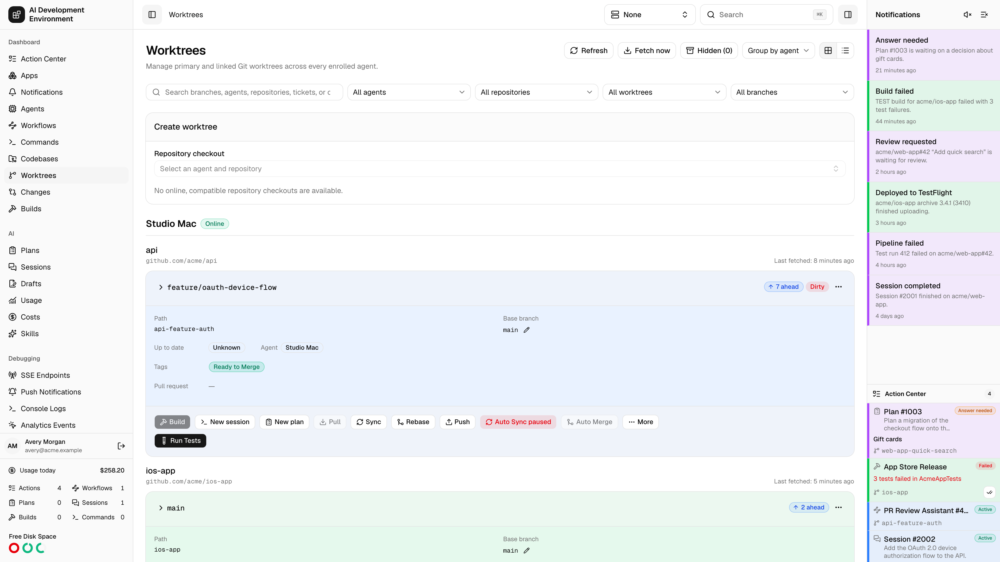

<p align="center">
  <picture>
    <source media="(prefers-color-scheme: dark)" srcset=".github/assets/logo-dark.svg">
    <source media="(prefers-color-scheme: light)" srcset=".github/assets/logo-light.svg">
    
  </picture>
</p>

<p align="center">A self-hosted control plane for AI-assisted development across your Macs.</p>

<p align="center">
  <a href="https://ai-development-environment.mintlify.app/">Documentation</a> ·
  <a href="https://ai-development-environment.mintlify.app/quickstart">Quickstart</a> ·
  <a href="https://ai-development-environment.mintlify.app/reference/development">Local development</a> ·
  <a href="https://github.com/bludesign/ai-development-environment/issues">Issues</a>
</p>

<p align="center">
  <picture>
    <source media="(prefers-color-scheme: dark)" srcset=".github/assets/worktrees-dark.png">
    <source media="(prefers-color-scheme: light)" srcset=".github/assets/worktrees-light.png">
    
  </picture>
</p>

## Documentation

Everything lives at [ai-development-environment.mintlify.app](https://ai-development-environment.mintlify.app/).

- [Introduction](/) — What the product does and how the pieces fit together
- [Quickstart](/quickstart) — Install via Homebrew, npm, or from source, and enroll an agent
- [Local development](/reference/development) — Run from source, browse commands, and use the screenshot pipeline
- [APIs](/reference/api) — GraphQL, codebase REST endpoints, and MCP
- [Database](/reference/database) — Prisma, migrations, and reclaiming space
- [Hosting and networking](/reference/hosting) — Public HTTPS, Cloudflare Access, and reverse proxies

## Install

```bash
brew tap bludesign/ai-development-environment
brew install ai-development-environment
brew services start ai-development-environment
```

On macOS, the Homebrew server uses Keychain credential storage by default. When
`APP_SECRET` is unset or blank, the server loads it from your login Keychain and
generates it on first startup. All server installations under the same macOS
account share this secret. An explicit `APP_SECRET` takes precedence and is never
copied into Keychain. Run `brew services` without `sudo`.

The secret lives under service `com.bludesign.ai-development-environment.app-secret`,
account `APP_SECRET`, separately from integration credentials. Back up this entry.
If Keychain access fails, unlock your login Keychain and grant server access, or
configure `APP_SECRET` explicitly in the server's environment. Restore the original
value if the entry is malformed. Removing an environment override switches to the
Keychain secret and can invalidate existing sessions and signed download links.

Or from npm:

```bash
npm install -g @ai-development-environment/server @ai-development-environment/control-agent
ai-development-environment
```

Or from docker:

```bash
docker run --name ai-development-environment \
  --publish 3090:3090 \
  --publish 3091:3091 \
  --volume ./data:/data \
  ghcr.io/bludesign/ai-development-environment:latest
```

Full instructions, including enrolling a control agent, are in the [Quickstart](https://ai-development-environment.mintlify.app/quickstart).

## License

MIT. See [`LICENSE.md`](LICENSE.md).
